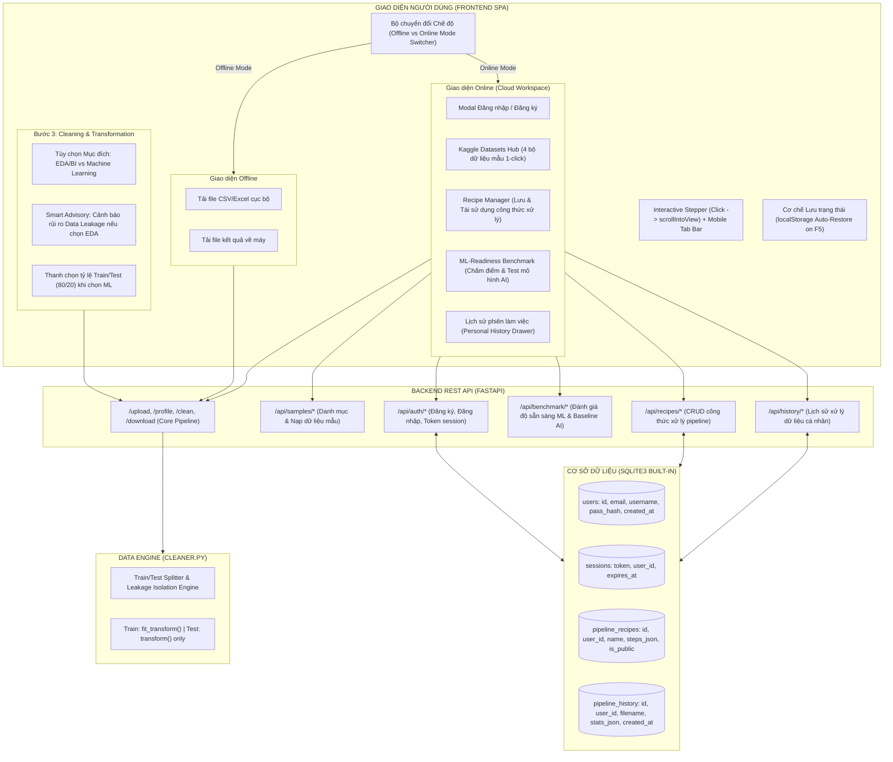

# 🚀 KẾ HOẠCH NÂNG CẤP TOÀN DIỆN HỆ THỐNG: DATASANITIZER 2.0 (ENTERPRISE EDITION)

Tài liệu này vạch ra kiến trúc và lộ trình kỹ thuật chi tiết để chuyển đổi **DataSanitizer** từ một công cụ đơn lẻ (local prototype) thành một **Nền tảng tiền xử lý dữ liệu chuẩn công nghiệp**, giải quyết triệt để nhận xét của giảng viên bộ môn Thiết kế & Lập trình Web (*"bài chưa có gì để chấm vì quá đơn giản"*).

---

## 1. MỤC TIÊU VÀ TRIẾT LÝ HỆ THỐNG (SYSTEM VISION)

Hệ thống DataSanitizer 2.0 được tái cấu trúc thành **2 chế độ vận hành độc lập** phục vụ 2 nhóm nhu cầu thực tế:

```
┌─────────────────────────────────────────────────────────────────────────────────┐
│                           DATASANITIZER 2.0 PLATFORM                            │
├───────────────────────────────────────┬─────────────────────────────────────────┤
│    🔒 CHẾ ĐỘ OFFLINE (PRIVACY-FIRST)   │       ☁️ CHẾ ĐỘ ONLINE (CLOUD WORKSPACE) │
│ • Không cần đăng nhập                  │ • Xác thực tài khoản (SQLite Auth & Session)│
│ • Không lưu trữ DB / Zero-retention   │ • Kaggle Sample Datasets Hub (1-click test) │
│ • Bảo mật dữ liệu nhạy cảm (Tài chính, y tế)│ • Pipeline Recipes (Lưu & tái dùng công thức)│
│ • Xử lý đệm cục bộ, tải file về máy   │ • ML-Readiness Benchmark (Chấm điểm AI) │
│                                       │ • Lịch sử phiên làm việc (Personal History) │
├───────────────────────────────────────┴─────────────────────────────────────────┤
│                      ✨ NỀN TẢNG CHUNG (CORE FOUNDATIONS)                       │
│ • Data Leakage Prevention Engine (Chọn mục đích EDA vs Machine Learning)        │
│ • State Persistence (F5 không mất dữ liệu đang làm nhờ localStorage)            │
│ • Interactive Stepper Navigation (Click cuộn mượt scrollIntoView + nút Back)   │
│ • Responsive Mobile Tabs (Thanh tab lướt mượt mà trên điện thoại)               │
│ • Chuẩn 3 Màu Chuyên Nghiệp (Quy tắc 60-30-10: Canvas, Slate Structure, Blue)  │
└─────────────────────────────────────────────────────────────────────────────────┘
```

> [!NOTE]
> **Phạm vi triển khai đợt này:** Tính năng *Restore Sheet* tạm thời được giữ nguyên để thành viên khác trong nhóm phụ trách hoàn thiện độc lập.

---

## 2. SƠ ĐỒ KIẾN TRÚC TỔNG THỂ (SYSTEM ARCHITECTURE)



---

## 3. CHI TIẾT KỸ THUẬT THEO TỪNG THÀNH PHẦN (TECHNICAL SPECIFICATIONS)

---

### PHẦN I: TRẢI NGHIỆM NGƯỜI DÙNG & GIAO DIỆN CỐT LÕI (UX & UI DESIGN)

#### 1. F5 Không Mất Dữ Liệu Đang Làm (State Persistence)
* **Vấn đề:** Khi người dùng đang upload file, khám dữ liệu hoặc chọn các bước xử lý mà lỡ bấm F5 hoặc tải lại trang, toàn bộ tiến trình trước đây bị biến mất.
* **Giải pháp:**
  * Mỗi khi có thay đổi trạng thái (chọn file, có kết quả profiling, thêm/sửa/xóa bước pipeline, chuyển giai đoạn), hệ thống tự động đồng bộ vào `localStorage`:
    ```javascript
    localStorage.setItem('datasanitizer_state', JSON.stringify({
      currentFileId: state.currentFileId,
      filename: state.filename,
      activeStepId: state.activeStepId,
      profileData: state.profileData,
      pipelineSteps: state.pipelineSteps,
      mode: state.mode // 'offline' hoặc 'online'
    }));
    ```
  * Khi trang web tải lại (`DOMContentLoaded`), hệ thống kiểm tra nếu có state cũ:
    * Tự động khôi phục giao diện đến đúng bước đang làm dở.
    * Hiển thị thanh thông báo nhẹ nhàng ở góc màn hình: *"Đã khôi phục phiên làm việc trước: [filename] [Bắt đầu phiên mới]"*.

#### 2. Điều Hướng Giai Đoạn Thông Minh & Tab Mobile (Interactive Stepper)
* **Thanh Stepper tương tác:**
  * Các bước Bước 1 (Tải dữ liệu), Bước 2 (Khám phá), Bước 3 (Làm sạch), Bước 4 (Tải về) trên thanh điều hướng trở thành các nút bấm tab (`role="tab"`).
  * Khi bấm vào một bước đã mở khóa, màn hình tự động cuộn mượt lên vị trí đó mà người dùng không cần phải dùng tay cuộn chuột:
    ```javascript
    document.getElementById(targetSectionId).scrollIntoView({ 
      behavior: 'smooth', 
      block: 'start' 
    });
    ```
  * Ở chân mỗi thẻ Card, thêm nút **"← Quay lại bước trước"** và **"Tiếp tục bước sau →"** giúp điều hướng 2 chiều trực quan.
* **Giao diện Tab Mobile (`@media (max-width: 768px)`):**
  * Thanh Stepper trên điện thoại chuyển thành dạng thanh tab cố định (Sticky Navigation) có thể cuộn ngang nhẹ nhàng bằng cử chỉ vuốt ngón tay.
  * Bấm vào tab nào sẽ lập tức lướt lên phần tử đó.

#### 3. Chuẩn Hóa Hệ 3 Màu Chuyên Nghiệp (Quy tắc 60-30-10)
* **Xóa bỏ hoàn toàn** dải màu chuyển động pastel hoạt họa `@keyframes gradientBG` (hồng, vàng) gây mất tập trung.
* **Bộ 3 màu chủ đạo:**
  * **60% Nền Canvas (Neutral):** `--bg-body: #f8fafc` (Xám sáng hiện đại, chống mỏi mắt) và `--bg-card: #ffffff`.
  * **30% Cấu trúc & Nội dung (Structure):** `--text-main: #0f172a` (Xanh đen Slate sang trọng), `--text-muted: #64748b`, `--border-color: #e2e8f0`.
  * **10% Điểm nhấn Hành động (Primary Action Accent):** `--primary: #2563eb` (Xanh dương công nghệ chuẩn SaaS), hover `--primary-hover: #1d4ed8`.
  * Điểm xuyết bổ trợ: Nhãn cảnh báo đỏ `#ef4444`, nhãn thành công xanh lá `#10b981`.

---

### PHẦN II: CƠ CHẾ MÃ HÓA & CHUẨN HÓA THÔNG MINH (DATA LEAKAGE PREVENTION ENGINE) ⭐⭐⭐

Đây là tính năng mang tính bước ngoặt giải quyết trọn vẹn thắc mắc về rò rỉ dữ liệu khi người dùng đưa 1 file thô lên web:

Tại Bước 3 (Làm sạch & Biến đổi), khi người dùng thêm cấu hình **Mã hóa phân loại (Encoding)** hoặc **Chuẩn hóa thang đo (Scaling)**:

#### 🔘 Giao diện cho phép chọn 1 trong 2 Mục đích sử dụng:
1. **Lựa chọn 1: Dành cho Phân tích Khám phá & Trực quan hóa (EDA & BI Reporting)** *(Mặc định)*
   * Thao tác trên toàn bộ bảng dữ liệu thành 1 file duy nhất.
   * **Hiển thị hộp Cảnh báo Thông minh (Smart Advisory Banner) màu vàng tinh tế ⚠️:**  
     > 💡 **Khuyến nghị Data Science:** *"Mã hóa trên toàn bộ bảng dữ liệu phù hợp cho Phân tích Khám phá (EDA), Ma trận Tương quan và Dashboard BI. Nếu bạn chuẩn bị dữ liệu cho bài toán Học máy (Machine Learning), việc mã hóa toàn bộ bảng có thể gây rò rỉ dữ liệu (Data Leakage) và Overfitting. Hãy chọn chế độ Huấn luyện Học máy bên dưới."*

2. **Lựa chọn 2: Dành cho Huấn luyện Học máy (Machine Learning Readiness - Anti Data Leakage)**
   * Kích hoạt thanh trượt chọn tỷ lệ phân tách: `Tập Train: [ 80% ]` | `Tập Test: [ 20% ]` (với `random_state=42`).
   * **Cách Backend (`cleaner.py`) xử lý cô lập:**
     * Chia DataFrame thành `train_df` và `test_df`.
     * Bộ mã hóa `OneHotEncoder` / `LabelEncoder` hoặc `StandardScaler`:
       * Trên tập Train: Gọi **`fit_transform(train_df)`** (vừa học danh mục vừa mã hóa).
       * Trên tập Test: Tuyệt đối chỉ gọi **`transform(test_df)`** với `handle_unknown='ignore'`. Không bao giờ học từ Test!
   * **Tải về ở Bước 4:**
     * Xuất ra **2 file riêng biệt**: `train_cleaned.csv` và `test_cleaned.csv` (hoặc 1 file nén `.zip` chứa cả 2 file).

---

### PHẦN III: CHẾ ĐỘ OFFLINE (PRIVACY-FIRST ZERO-RETENTION MODE)

* **Mục tiêu:** Đáp ứng tiêu chuẩn bảo vệ dữ liệu tuyệt đối (tương tự các tiêu chuẩn GDPR/HIPAA cho dữ liệu ngân hàng, y tế, thông tin cá nhân).
* **Đặc điểm:**
  * Người dùng không cần tạo tài khoản hay đăng nhập.
  * Toàn bộ thao tác chỉ sinh file xử lý tạm thời trên server và tải trực tiếp về máy.
  * Không lưu bất kỳ thông tin nào vào Database trung tâm.
  * Có nhãn nổi bật trên giao diện: 🛡️ *"Chế độ Cục bộ: Bảo mật dữ liệu 100% - Không lưu trữ trên Cloud"*.

---

### PHẦN IV: CHẾ ĐỘ ONLINE (CLOUD WORKSPACE & DATA SCIENCE ACCELERATOR)

Hệ thống cung cấp cơ sở dữ liệu SQLite (`data/datasanitizer.db`) zero-setup, tích hợp đầy đủ các tính năng cao cấp:

#### 1. Hệ Thống Tài Khoản (Authentication & Session Management)
* **Cơ sở dữ liệu SQLite:**
  * Bảng `users`: `id, email, username, password_hash, salt, created_at`.
  * Bảng `sessions`: `token, user_id, expires_at`.
* **API:**
  * `POST /api/auth/register`: Đăng ký tài khoản.
  * `POST /api/auth/login`: Đăng nhập, cấp Session token (lưu cookie & Bearer).
  * `POST /api/auth/logout`: Đăng xuất.
  * `GET /api/auth/me`: Lấy thông tin user hiện tại.
* **UI:** Modal Đăng ký / Đăng nhập mượt mà, khi đăng nhập xong hiển thị Profile Badge trên thanh Header.

#### 2. Kaggle Sample Datasets Hub (Kho Dữ Liệu Mẫu 1-Click)
* Tích hợp sẵn 4 bộ dữ liệu kinh điển vào thư mục `data/samples/`:
  1. 🏠 **Melbourne Housing:** Dự đoán giá nhà (dữ liệu hỗn hợp chữ/số/tiền tệ).
  2. 🚢 **Titanic Disaster:** Phân loại sống sót (nhiều dữ liệu khuyết thiếu).
  3. 🌸 **Iris Species:** Phân loại thực vật (dữ liệu số học chuẩn).
  4. 📊 **Customer Churn:** Viễn thông (dự đoán khách hàng rời bỏ).
* **API:**
  * `GET /api/samples`: Danh sách các tập dữ liệu mẫu kèm thẻ tag và mô tả ngắn.
  * `POST /api/samples/{sample_id}/load`: Nạp tức thì bộ dữ liệu mẫu vào phiên làm việc chỉ với 1 click, người dùng có thể khám phá và tiền xử lý ngay mà không cần chuẩn bị file trong máy.

#### 3. Pipeline Recipes / Presets (Lưu & Tái Sử Dụng Công Thức Xử Lý)
* **Ý nghĩa:** Tránh việc người dùng phải thao tác lại các bước xử lý lặp đi lặp lại trên các tập dữ liệu tương tự.
* **Cách hoạt động:**
  * Khi người dùng đã cấu hình xong một chuỗi bước xử lý tại Bước 3 (ví dụ: *Xóa cột thiếu > 50% $\rightarrow$ Điền Median $\rightarrow$ Cắt ngoại lai IQR 1.5 $\rightarrow$ One-Hot Encoding*), họ có thể nhấn nút **"Lưu thành Recipe (Save Recipe)"** và đặt tên (ví dụ: *"Công thức chuẩn hóa dữ liệu Nhà đất"*).
  * Công thức được lưu vào bảng `pipeline_recipes` trong SQLite.
  * Khi nạp một file mới, người dùng chỉ cần mở danh sách **Recipe Library**, chọn công thức mong muốn và nhấn **"Áp dụng công thức"** $\rightarrow$ toàn bộ các bước được tự động điền sẵn và chạy ngay lập tức.
  * Hệ thống cũng cung cấp sẵn 3 Recipe tiêu chuẩn: *"Bộ lọc dữ liệu khuyết thiếu"*, *"Xử lý nhiễu & Ngoại lai"*, *"Chuẩn hóa dữ liệu số và Categorical"*.

#### 4. Đánh Giá Độ Sạch & Sức Khỏe Dữ Liệu (Data Quality & Hygiene Score)
* **Ý nghĩa:** Đo lường chính xác mức độ hoàn thiện của dữ liệu sau khi làm sạch theo chuẩn mực Khoa học Dữ liệu, không chạy mô hình dự đoán để tránh tranh cãi rò rỉ dữ liệu / overfitting.
* **Cách hoạt động:**
  * Tại Bước 4 (sau khi làm sạch dữ liệu), hệ thống cung cấp bảng **"Thẻ Sức Khỏe Dữ Liệu (Data Health Card)"** với thang điểm 0 - 100 điểm:
    1. **Độ đầy đủ (Completeness - 30 điểm):** Đo lường tỷ lệ các ô dữ liệu không bị Null/NaN (mục tiêu 0% ô trống).
    2. **Khử trùng lặp (Deduplication - 20 điểm):** Kiểm định tỷ lệ bản ghi trùng lặp (0% duplicate).
    3. **Tính đồng nhất kiểu dữ liệu (Type Uniformity - 25 điểm):** Tỷ lệ các cột đã được chuyển đổi về số học hoặc danh mục chuẩn.
    4. **Mức độ bảo toàn dữ liệu (Data Retention - 25 điểm):** Bảo đảm không drop quá nhiều dòng làm suy giảm kích thước mẫu.
    5. **Chẩn đoán nâng cao (Diagnostics):** Cảnh báo tự động các cột hằng số (Zero-variance columns) hoặc các cột văn bản có quá nhiều giá trị phân tán (High cardinality text).
  * Trả về bảng tổng kết tóm tắt độ sạch và xếp hạng chất lượng dữ liệu (Xuất sắc / Tốt / Trung bình / Kém).

#### 5. Personal History & Cloud Audit Log (Lịch Sử Phiên Làm Việc Cá Nhân)
* **Ý nghĩa:** Quản lý không gian làm việc cá nhân của từng sinh viên/người dùng.
* **Cách hoạt động:**
  * Bảng `pipeline_history` trong cơ sở dữ liệu ghi lại toàn bộ các lần làm sạch dữ liệu của tài khoản:
    * Tên tập dữ liệu.
    * Thời gian xử lý.
    * Số dòng/cột trước và sau khi làm sạch.
    * Danh sách các bước tiền xử lý đã áp dụng.
    * Tên file kết quả sạch để người dùng có thể tải lại file bất kỳ lúc nào mà không cần chạy lại từ đầu.
  * Trên giao diện, người dùng click vào nút **"Lịch sử xử lý"** để mở bảng trượt (Drawer) hiển thị danh sách các phiên làm việc trước đó.

---

## 4. DANH MỤC FILE THAY ĐỔI & TẠO MỚI (IMPLEMENTATION WORKLIST)

```
d:\Data Sanitizer/
├── backend/
│   ├── database.py              # [NEW] Khởi tạo SQLite, quản lý bảng users, sessions, recipes, history
│   ├── main.py                  # [MODIFY] Đăng ký các router mới: auth, samples, recipes, benchmark, history
│   ├── services/
│   │   ├── cleaner.py           # [MODIFY] Thêm engine chia Train/Test & cô lập fit/transform chống rò rỉ dữ liệu
│   │   └── pipeline_runner.py   # [MODIFY] Hỗ trợ chạy pipeline ở chế độ ML (sinh train_clean & test_clean)
│   └── routers/
│       ├── auth.py              # [NEW] API Đăng ký, Đăng nhập, Đăng xuất, Session token
│       ├── samples.py           # [NEW] API Danh mục 4 dữ liệu mẫu Kaggle & 1-click loading
│       ├── recipes.py           # [NEW] API Lưu, đọc, áp dụng Pipeline Recipes
│       ├── benchmark.py         # [NEW] API Đánh giá ML-Readiness Score & Baseline Test
│       └── history.py           # [NEW] API Xem lịch sử xử lý và tải lại file kết quả
├── data/
│   ├── datasanitizer.db         # [AUTO] File SQLite database (tạo tự động)
│   └── samples/                 # [NEW] Thư mục chứa 4 file CSV mẫu (Melbourne, Titanic, Iris, Churn)
├── frontend/
│   ├── index.html               # [MODIFY] Header Mode Switcher, Auth Modal, Kaggle Hub, Recipe Library, Leakage Warning, Mobile Tabs
│   └── assets/
│       ├── css/
│       │   ├── base.css         # [MODIFY] Thay dải màu pastel bằng hệ 3 màu 60-30-10, Stepper interactive style
│       │   └── sections.css     # [MODIFY] Style cho Recipe Card, Kaggle Hub, Leakage Alert Box, Mobile Sticky Tabs
│       └── js/
│           ├── state.js         # [MODIFY] Hàm saveStateToStorage(), loadStateFromStorage() (F5 phục hồi)
│           └── script.js        # [MODIFY] Điều khiển Mode Switcher, Auth flow, Train/Test toggle, Smooth scroll
└── tests/
    ├── test_auth.py             # [NEW] Test đăng ký, đăng nhập, phân quyền session
    ├── test_samples.py          # [NEW] Test nạp dữ liệu mẫu Kaggle
    ├── test_recipes.py          # [NEW] Test lưu và tái sử dụng pipeline recipes
    ├── test_benchmark.py        # [NEW] Test tính điểm ML-Readiness
    └── test_leakage_guard.py    # [NEW] Test engine chia Train/Test và fit/transform độc lập
```

---

## 5. PHÂN CÔNG CÔNG VIỆC THEO VAI TRÒ TỪNG THÀNH VIÊN (TASK ALLOCATION & WORKLOAD DISTRIBUTION)

Khối lượng công việc nâng cấp DataSanitizer 2.0 được phân chia đồng đều (34% - 33% - 33%), đúng theo thế mạnh chuyên môn và vai trò đã phân công trong báo cáo môn học:

| STT | Thành viên & Mã SV | Vai trò chính | Chi tiết đầu việc phụ trách nâng cấp 2.0 | Tỷ lệ đóng góp |
| :---: | :--- | :--- | :--- | :---: |
| **1** | **Nguyễn Hữu Luân**<br>*(Mã SV: 11247191)* | **Trưởng nhóm, Data Engine & Kiến trúc hệ thống** | • Thiết kế kiến trúc phân tách 2 chế độ (Offline vs Online).<br>• Thiết kế mô hình cơ sở dữ liệu SQLite (`database.py`): tables users, sessions, recipes, history.<br>• Nâng cấp lõi `cleaner.py`: Lập trình thuật toán phân tách Train/Test và cơ chế cô lập `fit_transform` (Train) vs `transform` (Test) chống Data Leakage.<br>• Xây dựng module đánh giá chất lượng dữ liệu & ML-Readiness Benchmark (`benchmark.py`).<br>• Viết unit test tự động: `test_leakage_guard.py` và `test_benchmark.py`. | **34%** |
| **2** | **Đào Trung Phúc**<br>*(Mã SV: 11242354)* | **Lập trình API Back-end & Pipeline Runner** | • Nâng cấp bộ điều phối `pipeline_runner.py`: Quản lý thực thi pipeline hai luồng Train/Test song song.<br>• Xây dựng phân hệ API Xác thực người dùng (`routers/auth.py`): Đăng ký, đăng nhập băm mật khẩu bảo mật (PBKDF2/SHA256), cấp session token và quản lý cookie.<br>• Xây dựng API Kho dữ liệu mẫu Kaggle (`routers/samples.py`): Cấp phát 1-click 4 bộ dữ liệu mẫu.<br>• Xây dựng API Quản lý công thức xử lý (`routers/recipes.py`) và Lịch sử cá nhân (`routers/history.py`).<br>• Viết unit test tự động: `test_auth.py`, `test_samples.py`, `test_recipes.py`. | **33%** |
| **3** | **Hoàng Hải Văn**<br>*(Mã SV: 11240301)* | **Lập trình Giao diện Front-end & UI/UX** | • Chuẩn hóa hệ thống thiết kế 3 màu (Quy tắc 60-30-10: Canvas `#f8fafc`, Structure `#0f172a`, Primary Accent `#2563eb`), xóa bỏ toàn bộ hoạt họa gradient pastel cũ.<br>• Xây dựng cơ chế khôi phục phiên làm việc (F5 không mất dữ liệu) bằng `localStorage` trong `state.js` và `script.js`.<br>• Nâng cấp thanh Stepper tương tác: Click chuyển bước tự động cuộn mượt (`scrollIntoView`), thêm nút "Quay lại bước trước", tối ưu Sticky Tabs cuộn ngang trên Mobile.<br>• Thiết kế giao diện Modal Đăng ký / Đăng nhập, Drawer Lịch sử cá nhân, Thẻ Kho dữ liệu mẫu Kaggle Hub 1-click.<br>• Thiết kế giao diện hộp Cảnh báo rò rỉ dữ liệu (Smart Advisory Banner) và thanh chọn tỷ lệ Train/Test tại Bước 3. | **33%** |
| | **TỔNG CỘNG** | | | **100%** |

---

## 6. KẾ HOẠCH KIỂM THỬ VÀ NGHIỆM THU (VERIFICATION PLAN)

### 1. Kiểm thử Tự động (Automated Test Suite)
* Viết đầy đủ unit tests cho các router mới trong `tests/`.
* Chạy toàn bộ test suite để đảm bảo không có bất kỳ regression nào:
  ```powershell
  pytest tests -v
  ```
  *(Đảm bảo 100% test pass, bao gồm 19 tests cũ và các tests mới).*

### 2. Kiểm thử Trải nghiệm Thủ công (Manual UX Walkthrough)
1. **Kiểm tra F5 (State Persistence):**
   - Nạp file hoặc chọn dữ liệu mẫu $\rightarrow$ Thêm 2 bước vào pipeline $\rightarrow$ Nhấn **F5** $\rightarrow$ Hệ thống tự khôi phục lại nguyên vẹn file, kết quả profiling và pipeline.
2. **Kiểm tra Điều hướng Stepper & Mobile Tabs:**
   - Click vào từng bước 1, 2, 3, 4 trên Stepper $\rightarrow$ Màn hình tự động cuộn mượt (`scrollIntoView`) lên vị trí đó.
   - Thử nghiệm trên kích thước màn hình Mobile (F12 Responsive) $\rightarrow$ Thanh tab lướt mượt mà.
3. **Kiểm tra Tính năng Encoding & Data Leakage Prevention:**
   - Chọn mục đích EDA $\rightarrow$ Thấy hộp cảnh báo Data Leakage màu vàng.
   - Chọn mục đích Machine Learning $\rightarrow$ Nhập tỷ lệ 80/20 $\rightarrow$ Chạy clean $\rightarrow$ Tải về nhận được cả `train_cleaned.csv` và `test_cleaned.csv`.
4. **Kiểm tra Chế độ Offline:**
   - Chuyển sang chế độ Offline $\rightarrow$ Upload file, clean dữ liệu bình thường, kiểm tra database không lưu vết.
5. **Kiểm tra Chế độ Online:**
   - **Đăng ký & Đăng nhập:** Tạo tài khoản mới, kiểm tra hiển thị profile.
   - **Kaggle Hub:** Bấm "Nạp dữ liệu" tại Melbourne Housing $\rightarrow$ Hệ thống tự động nạp và mở Bước 2 tức thì.
   - **Pipeline Recipes:** Cấu hình 3 bước $\rightarrow$ Bấm "Lưu thành Recipe" $\rightarrow$ Nạp file khác $\rightarrow$ Chọn Recipe vừa lưu $\rightarrow$ Hệ thống tự động áp dụng.
   - **ML-Readiness Benchmark:** Bấm "Chấm điểm dữ liệu & Test AI" $\rightarrow$ Hiển thị thanh đo điểm.
   - **Personal History:** Bấm "Lịch sử của tôi" $\rightarrow$ Hiển thị danh sách các phiên đã xử lý trước đó.
6. **Kiểm tra Mã màu 3 Tone:**
   - Đảm bảo toàn bộ ứng dụng chỉ sử dụng đúng 3 tone màu chuẩn (Xám sáng 60%, Slate structure 30%, Royal Blue 10%), không còn màu pastel lòe loẹt.

---

> [!TIP]
> Bạn vui lòng nhấn nút **Proceed** hoặc gửi phản hồi xác nhận kế hoạch nâng cấp trên để chúng ta bắt đầu triển khai code ngay!
